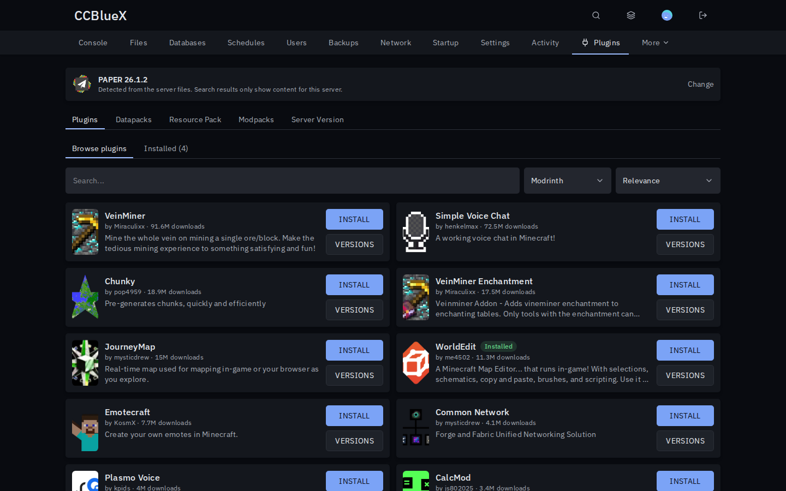
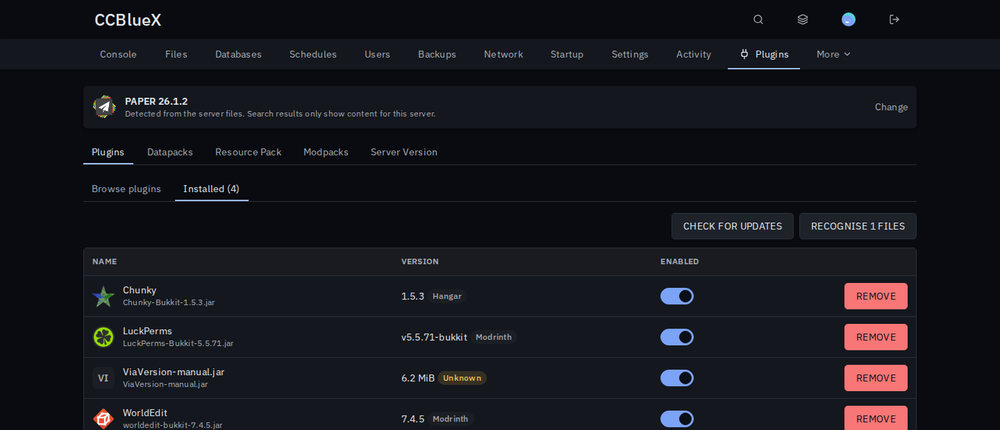
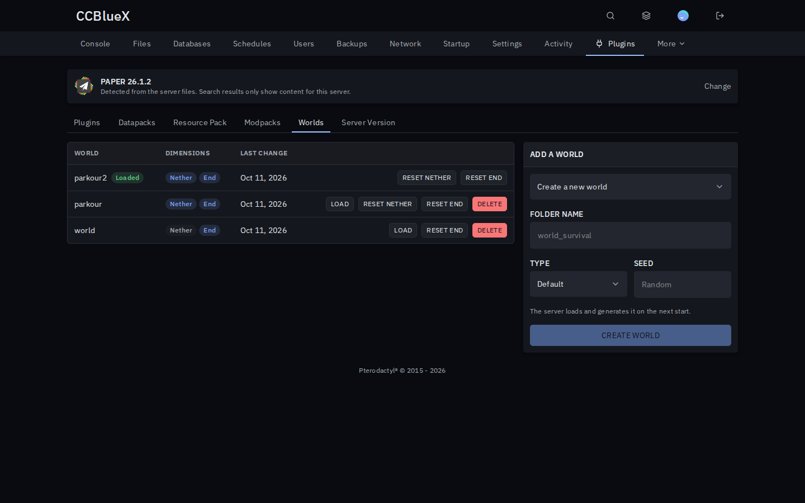
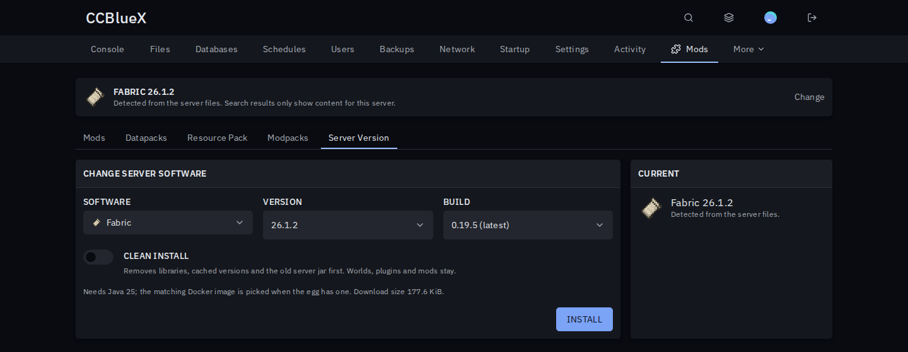

# Minecraft Content for Pterodactyl

Plugins, mods, modpacks, worlds and server versions for your Minecraft servers, in one tab.

## Install

1. Download `minecraft-content-<version>.pteroext` from the [latest release](https://github.com/CCBlueX/Pterodactyl-Extension-Minecraft-Content/releases/latest).
2. Open **Admin → Extensions**, click **Install** and pick the file.
3. Enable it and reload the panel.

Plugin servers get a **Plugins** tab, modded and vanilla servers a **Mods** tab. Switching server software opens the matching tab automatically.

## Features

- **Plugins and mods** from Modrinth, Hangar, SpigotMC and CurseForge, filtered for the server's software and version. Datapacks and resource packs too.
- **Updates**: one click per file or all at once, and new server builds with their changelog. Files you uploaded yourself are recognised by their hash.
- **Modpacks** from Modrinth, CurseForge and FTB, with backup and the right server software. Switch versions or uninstall without leftovers.
- **Worlds**: create, switch and delete worlds, reset the Nether or End, and install maps from a link, an upload or CurseForge.
- **Server version**: switch between Paper, Purpur, Fabric, Forge, NeoForge, Velocity and more, with the matching Java image. The server moves to the matching egg, so Startup and Reinstall stay correct.

## Permissions

Subusers get a **Minecraft content** group in the server's **Users** tab: browse, install, install modpacks, manage worlds and change the version.

## Settings

**Admin → Extensions → Minecraft Content**

| Setting | What it does |
| --- | --- |
| CurseForge API key | Turns on CurseForge. Get a key at [console.curseforge.com](https://console.curseforge.com). |
| Before a modpack installs | Preselected clean-up: only the previous pack's files (smart), all mod folders, or nothing. |

Modpacks and version changes run in the background, so the panel's queue worker has to run. The Docker image runs it already.

---

Inspired by the Pelican plugins Minecraft Mod Manager, Minecraft Modrinth, Modpack Manager and Minecraft Version Changer. Server jars come from [MCJars](https://mcjars.app).
